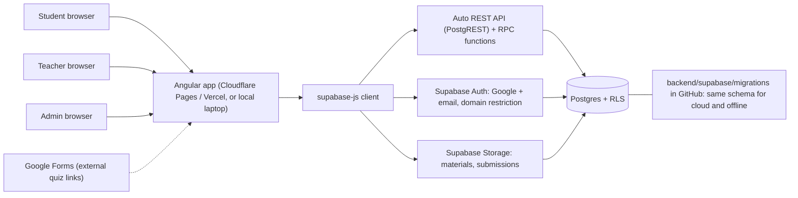
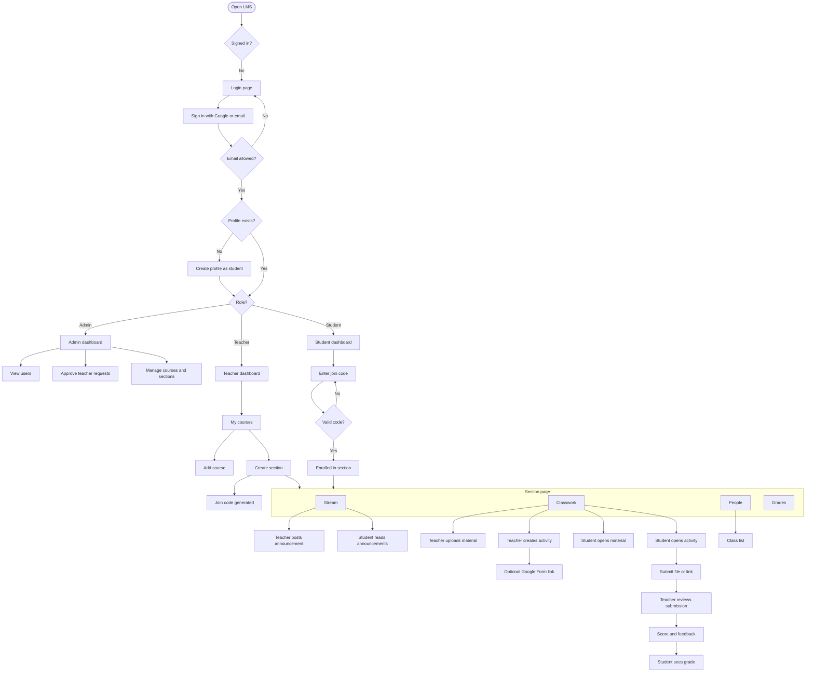
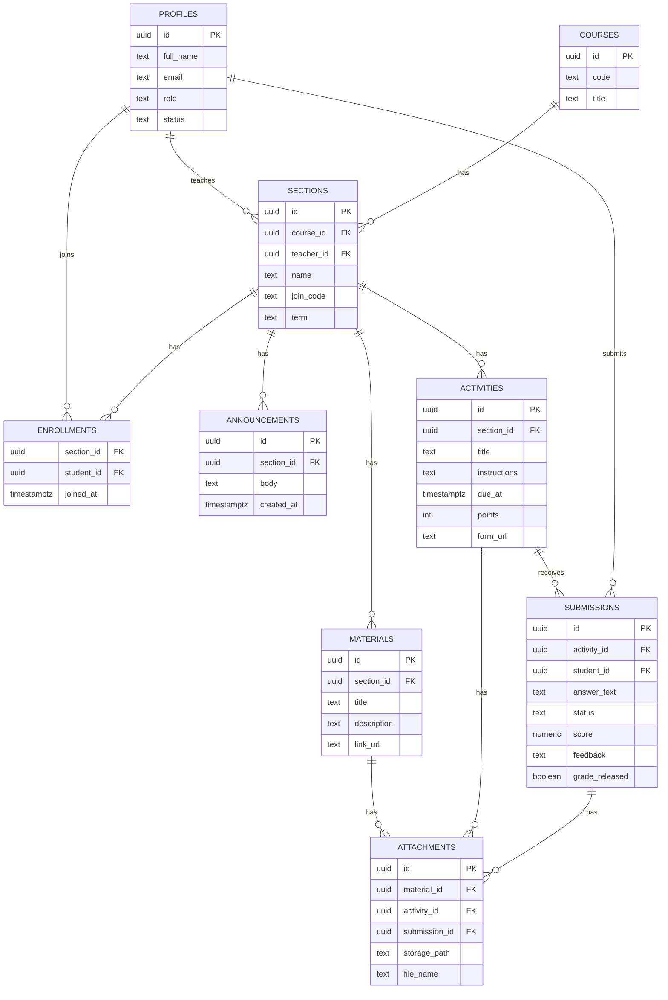

# PUP Classroom-Style LMS: Project Plan

A web-based LMS in the style of Google Classroom and Canvas, built for our college.
Team: 5 people (3rd year). Goal: actually usable by about 50 students plus a professor, on a free stack.

---

## About This Project

**Working title:** PUP Classroom LMS
**Course:** Systems Integration and Architecture (3rd year)
**Deadline:** November 11, 2026 (15 days from the start on October 27)
**Team:** 5 members

### What we are building

A web-based learning management system in the style of Google Classroom and Canvas, shaped around how our college actually runs classes. Teachers handle courses and sections, post announcements, upload materials (slides, PDFs, links), and create activities. Students join a section with a code, read and download materials, submit activities, and see their grades.

### Why we are building it

- It is our Systems Integration and Architecture project, so it has to show how separate parts (frontend, authentication, database, file storage, hosting) are chosen and connected on purpose.
- We want it to be **actually usable**: about 50 students and our professor should be able to use it in a real demo.
- It has to be **free to run** and **easy to deploy**, because we have no budget and little time.

### Who uses it

| User    | What they do                                                                                   |
| ------- | ---------------------------------------------------------------------------------------------- |
| Student | Joins sections, views materials, submits activities, checks grades                             |
| Teacher | Manages courses and sections, posts announcements and materials, creates and grades activities |
| Admin   | Approves teacher accounts and manages users and courses                                        |

### Our approach

1. **Use managed services instead of writing a backend.** Supabase gives us the database, login, file storage, and API. That removes the biggest source of deployment trouble and lets us spend our time on features.
2. **Keep what we already know.** Angular is the frontend because it is the framework from our web development course.
3. **Database first, security in the database.** The schema is written as versioned migration files in the repo. Access rules (who can see what) are enforced with Row-Level Security, so they hold even if the frontend has a bug.
4. **Build in vertical slices.** One feature at a time, all the way from database to screen (for example "teacher posts announcement, student sees it"), instead of finishing all the database work and then all the screens.
5. **Reuse instead of rebuilding.** Quizzes are Google Form links. Slide viewing is PDF or link based. No real-time editing and no custom quiz engine.
6. **Small, reviewed changes.** Everyone works on feature branches, and nothing reaches `main` without a pull request and a review.
7. **Offline-ready by design.** Because the schema lives in the repo, the same system can run on one laptop for an offline demo.

### In scope and out of scope

| In scope (MVP)                   | Out of scope (for now)                            |
| -------------------------------- | ------------------------------------------------- |
| School-email sign-in and roles   | Real-time collaborative editing                   |
| Courses, sections, join codes    | Native quiz engine (we link Google Forms instead) |
| Announcements                    | Mobile app                                        |
| Materials upload and viewing     | Video calls or chat                               |
| Activities, submissions, grading | Payments, SSO beyond Google                       |
| Student grade view               | Email or push notifications                       |

### Definition of success

- A teacher can create a section, post materials and an activity, and grade a submission.
- A student can join with a code, open materials, submit, and see the grade.
- Only `@iskolarngbayan.pup.edu.ph` accounts (plus approved teacher accounts) can get in.
- It is deployed at a public URL and runs for about 50 users, with an offline fallback for the demo.

### How to read this document

Sections 0 and 1 cover decisions and the stack. Section 2 is the setup (Lead first, then everyone else) plus the Git workflow. Section 3 covers roles and folder ownership, and Section 4 covers the timeline. Section 5 has the diagrams the code should follow. Section 6 is the checklist for finishing setup.

---

## 0. Confirmed Requirements

| #   | Topic               | Decision                                                                                                                                                                                                                                                                                   |
| --- | ------------------- | ------------------------------------------------------------------------------------------------------------------------------------------------------------------------------------------------------------------------------------------------------------------------------------------ |
| 1   | Backend requirement | None imposed by the professor. We choose what is easiest to deploy and free.                                                                                                                                                                                                               |
| 2   | Roles               | **Student, Teacher, Admin.** Admin is included because teacher accounts must be approved by someone, otherwise anyone with a school email could become a teacher.                                                                                                                          |
| 3   | Integration         | Sign-in restricted to `@iskolarngbayan.pup.edu.ph`, with Google sign-in as the main method.                                                                                                                                                                                                |
| 4   | Core scope          | Teacher takes **courses** and handles **sections** under them. Teacher can **announce**, **upload materials**, and **post activities**. Quizzes are **Google Form links** (no native quiz engine). Student sees section stream, materials, activities, submits work, and views **grades**. |
| 5   | Offline             | Must work offline for the demo. We **design for it now** (see Section 2, Part C2) but build it later.                                                                                                                                                                                      |

### Points to settle early

- **"API from SIA":** Supabase auto-generates a REST API over our tables (PostgREST), and we can add custom endpoints as Postgres functions (RPC) or Edge Functions, for example `join_section(code)`. That counts as an API layer without us hosting a server. If the professor wants a visibly separate backend, we can add a small Node API later without redoing the frontend.
- **Teacher email domain:** Teachers at PUP may use a different domain than students, such as `@pup.edu.ph`. Check this before locking the email restriction. The plan below uses an allowlist so it handles both.
- **Offline vs cloud:** the decision that makes offline cheap (database schema kept as migration files in the repo) has to be made now, even though the offline work happens later.

---

## 1. Technology Stack

| Layer            | Choice                                                                                        | Why                                                                                              | Cost      |
| ---------------- | --------------------------------------------------------------------------------------------- | ------------------------------------------------------------------------------------------------ | --------- |
| Frontend         | **Angular** + Angular Material                                                                | Used in our web dev course. Material gives tables, dialogs, forms, and tabs out of the box.      | Free      |
| Database         | **Supabase Postgres**                                                                         | Relational data fits an LMS (courses, sections, enrollments, submissions).                       | Free tier |
| Auth             | **Supabase Auth** (Google OAuth + email/password fallback)                                    | Built in, no custom login code.                                                                  | Free tier |
| File storage     | **Supabase Storage**                                                                          | PPT/PDF/DOCX materials and student submissions.                                                  | Free tier |
| Access control   | **Postgres Row-Level Security (RLS)**                                                         | This is our "backend": rules like "students only see sections they joined" live in the database. | Free      |
| Custom logic     | Postgres functions (RPC) or Supabase Edge Functions                                           | Join by code, grade release, admin actions.                                                      | Free tier |
| Frontend hosting | **Cloudflare Pages** or **Vercel** (pick one)                                                 | Auto-deploys from GitHub on every push to `main`.                                                | Free      |
| Source control   | **GitHub** (one repo, PRs required)                                                           | Team workflow.                                                                                   | Free      |
| Offline demo     | **Docker Desktop + Supabase CLI** (local Supabase) + built Angular app served from one laptop | Same schema and same code, running locally.                                                      | Free      |

### What we are NOT using, and why

- **Laravel/PHP:** free PHP hosting is unreliable (sleeping apps, limits that change), and it adds a second deployment for 5 people to debug. Supabase already covers auth, DB, and storage.
- **Real-time collaborative editing:** out of scope. Google Classroom does not do this either.
- **Native quiz engine:** replaced by Google Form links.

### Free tier checks (do this on Oct 28)

Free-tier limits change. Confirm the current numbers on Supabase and the host's pricing pages before committing:

- Database size and storage size
- Max upload file size
- **Project pausing after inactivity** (Supabase free projects have paused after about a week idle). Open the app the day before any demo, and during development a teammate should log in at least weekly.
- Monthly active users and bandwidth

Mitigations: cap uploads (for example 10 MB), accept only PDF/PPTX/DOCX/images, and encourage PDF exports of slides.

---

## 2. Setup Guide

The setup is split by who does it, so the team only has to pull and run:

- **Part A: Lead does this first** (Oct 27-28). Accounts, repo scaffold, Supabase, hosting, environment files.
- **Part B: Everyone else does this** after the Lead announces "repo is ready". Install, clone, run.
- **Part C: Shared reference** (email restriction, deployment, branching workflow).

---

### Part A: Lead does this first

#### A1. Accounts and access

| Account                    | Steps                                                                                                                                                                  |
| -------------------------- | ---------------------------------------------------------------------------------------------------------------------------------------------------------------------- |
| GitHub repo                | Create `pup-lms`. Add the 4 teammates as collaborators.                                                                                                                |
| Supabase project           | Create the project. Invite the **DB** and **Auth** people as developers (the other teammates only need the project URL and anon key, which are committed in the repo). |
| Cloudflare Pages or Vercel | Create the account and connect the GitHub repo (see A5).                                                                                                               |
| Google Cloud project       | Create an OAuth client (Web application) for Google sign-in (see A3).                                                                                                  |

#### A2. Create the repo scaffold

```bash
mkdir pup-lms && cd pup-lms
git init

# Frontend (Angular). Answer "No" to SSR/SSG.
npm i -g @angular/cli
ng new frontend --routing --style=scss --skip-git
cd frontend
ng add @angular/material
ng generate environments
npm i @supabase/supabase-js
cd ..

# Backend (Supabase CLI lives here)
mkdir backend && cd backend
npm init -y
npm i -D supabase
npx supabase init
cd ..

mkdir docs .github
```

Result:

```
pup-lms/
  frontend/    Angular app
  backend/     Supabase project (migrations, functions, seed)
  docs/        this plan, diagrams, user guide
  .github/     CODEOWNERS, PR template
```

#### A3. Supabase and Google sign-in

1. Link and log in from the backend folder:
   ```bash
   cd backend
   npx supabase login
   npx supabase link --project-ref <project-ref>
   ```
2. Create an empty first migration to confirm the pipeline works, then push it:
   ```bash
   npx supabase migration new init_schema
   npx supabase db push
   ```
3. In the Supabase dashboard: create private storage buckets `materials` and `submissions`, and set the file size limit.
4. Google sign-in: in Google Cloud, create an OAuth client and add the callback URL shown in Supabase (Authentication, Providers, Google). Paste the client ID and secret into Supabase.
5. In Supabase (Authentication, URL Configuration), add the Site URL and allowed redirect URLs: `http://localhost:4200` and your deployed URL. For PR preview deployments, a wildcard redirect URL may be needed (verify in the Supabase docs).

#### A4. Environment files (committed, so teammates just pull)

The Supabase **anon key is designed to be public**; RLS is what protects the data. So commit it, and teammates need no extra config.

`frontend/src/environments/environment.development.ts` (used by `npm start`, points to the cloud project):

```ts
export const environment = {
  production: false,
  supabaseUrl: "https://<project-ref>.supabase.co",
  supabaseAnonKey: "<anon key>",
};
```

Copy it to `environment.ts` for production (same values, `production: true`).

For the offline demo, add `environment.local.ts` with the local Supabase URL (`http://127.0.0.1:54321`) and the local anon key printed by `npx supabase start`. Add a `local` build configuration in `angular.json` with a file replacement, and an npm script `"start:local": "ng serve --configuration local"`.

**Never commit:** the `service_role` key, the Google client secret, or the database password.

#### A5. Hosting (auto-deploy)

In Cloudflare Pages or Vercel, connect the repo and set:

| Setting                       | Value                                                                       |
| ----------------------------- | --------------------------------------------------------------------------- |
| Root directory                | `frontend`                                                                  |
| Build command                 | `npm run build`                                                             |
| Output directory              | as shown in the Angular build log (typically `dist/<project-name>/browser`) |
| Branch deployed to production | `main`                                                                      |

Confirm that refreshing on a deep link (for example `/dashboard`) works. If not, add the SPA fallback rule so unknown paths serve `index.html`.

#### A6. Repo hygiene

- `.gitignore` covering `node_modules`, `dist`, `.angular`, `.env*`, and `backend/supabase/.temp`.
- Branch protection on `main`: require a pull request and 1 approval. **Check:** on a private repo with a free GitHub account, branch protection may not be enforced. Options are the GitHub Student Developer Pack, a public repo (fine here, since the anon key is public and no secrets are committed), or agreeing as a team to never push to `main` directly.
- `.github/CODEOWNERS` (see Section 3) and a short PR template (what changed, how to test, screenshot).
- A `README.md` with the "Part B" quick start below.

#### A7. Verify, then announce

1. Push to `main` and confirm the deployed URL loads.
2. Run `npm start` in `frontend/` from a fresh clone to prove a teammate's experience works.
3. Send this to the group chat:

> Repo is ready: `<repo-url>`. Do Part B in the plan (install Node, clone, `cd frontend`, `npm install`, `npm start`). Reply when localhost:4200 loads. Do not push to `main`; create your own branch.

---

### Part B: Everyone else does this

#### B1. Install

| Tool                  | Who                         | Notes                                                   |
| --------------------- | --------------------------- | ------------------------------------------------------- |
| Node.js (current LTS) | Everyone                    | Check with `node -v`.                                   |
| Git                   | Everyone                    |                                                         |
| VS Code               | Everyone                    | Extensions: Angular Language Service, ESLint, Prettier. |
| Docker Desktop        | **DB person and Lead only** | For the local/offline database. 8 GB RAM recommended.   |

You do **not** need to install the Angular CLI globally. `npm start` uses the one in the project.

#### B2. Accept invites

- GitHub: accept the repo invitation.
- Supabase: only the DB and Auth people accept the project invite. The rest do not need dashboard access.

#### B3. Clone and run

```bash
git clone <repo-url>
cd pup-lms/frontend
npm install
npm start
```

Open `http://localhost:4200`. The environment is already configured, so there is nothing to paste.

#### B4. Create your branch before touching anything

```bash
git checkout main
git pull
git checkout -b feat/<area>-<task>
```

#### B5. Your first task

| Role                          | Extra setup                                                                                                                     | First task                                                                                 |
| ----------------------------- | ------------------------------------------------------------------------------------------------------------------------------- | ------------------------------------------------------------------------------------------ |
| **DB / Supabase**             | `cd backend`, `npm install`, `npx supabase login`, `npx supabase link --project-ref <ref>`, `npx supabase start` (needs Docker) | Draft the schema migration from the ERD in Section 5.3                                     |
| **Auth / Admin / Shell**      | Work with Lead on Google sign-in settings                                                                                       | Login page, auth service, route guards, app layout                                         |
| **Teacher side**              | None                                                                                                                            | `features/courses/` with a **mock service** (fake data, same method names as the real one) |
| **Student side + Activities** | None                                                                                                                            | `features/dashboard/` with a join-section dialog using a **mock service**                  |

Mock first, swap later: when the schema is merged, only the service file changes.

#### B6. Everyday commands

```bash
git pull origin main          # bring your branch up to date (do this daily)
git add .
git commit -m "add join section dialog"
git push -u origin feat/<area>-<task>
# then open a Pull Request on GitHub
```

#### B7. Done with setup when

Your name is ticked on the checklist in Section 6.

---

### Part C: Shared reference

#### C1. Email restriction and roles

Google's domain hint is only a hint, so enforce it in the database too. The Auth person writes this as its own migration file (`backend/supabase/migrations/..._auth_profiles.sql`), and the DB person reviews it. Adapt it for the teacher domain or an allowlist table.

```sql
create or replace function public.enforce_school_email()
returns trigger language plpgsql security definer as $$
begin
  if new.email is null
     or new.email not ilike '%@iskolarngbayan.pup.edu.ph' then
    raise exception 'Only @iskolarngbayan.pup.edu.ph emails are allowed';
  end if;
  return new;
end; $$;

create trigger enforce_school_email
before insert on auth.users
for each row execute function public.enforce_school_email();
```

Role handling:

- New users get a `profiles` row with `role = 'student'`.
- Someone who needs to be a teacher requests it, and an **admin approves** (sets `role = 'teacher'`).
- Role checks happen in two places: Angular route guards (for UX) and RLS policies (for real security).

#### C2. Deployment

**Online (default):** push to `main`, and the host builds the `frontend/` folder automatically. The database changes ship separately: from `backend/`, run `npx supabase db push` (Lead or DB person only).

**Offline demo (tested Nov 8-9, designed now):**

1. On the demo laptop, from `backend/`: `npx supabase start` (Docker), then `npx supabase db reset` to apply migrations and `seed.sql`.
2. Build Angular with the `local` configuration and serve `dist/` from the same laptop.
3. Students join the laptop's hotspot or LAN and open `http://<laptop-ip>:<port>`.
4. Caveats to test: LAN reachability of the local Supabase ports, firewall rules, and that **Google sign-in needs internet**, so the offline build uses email/password with seeded demo accounts.

#### C3. Git workflow

**Recommendation:** `main` plus short-lived branches. No shared `feat` branch.

| Branch               | Purpose                                                           |
| -------------------- | ----------------------------------------------------------------- |
| `main`               | Protected. Always working. Auto-deploys to the live URL.          |
| `feat/<area>-<task>` | One task, one person. Example: `feat/courses-create-section`.     |
| `fix/<what>`         | Bug fixes. The only kind of PR allowed after the Nov 7 freeze.    |
| `db/<what>`          | Schema or RLS changes (DB person, and others adding a migration). |

Why not one shared `feat` branch: five people committing to the same branch means constant conflicts, half-finished work blocking others, and one huge risky merge into `main` at the end. Why not a `dev` branch: extra merging overhead in 15 days, and PR preview deployments already give a safe place to test.

Rules:

1. Branches live at most 2 days. Small PRs (aim for under 300 lines).
2. Pull `main` into your branch daily and before opening a PR.
3. Every PR needs 1 review, ideally from the owner of the folders it touches (CODEOWNERS requests them automatically).
4. Squash and merge, then delete the branch.
5. Never edit a migration that has already been applied. Add a new one.
6. No secrets in commits.

---

## 3. Roles and Folder Ownership

The project is split into `frontend/` and `backend/` so it is clear who edits what. Each person works mainly in their own folders.

| #   | Role                                    | Side                                      | Typically configures and edits                                                                                                                                                                                                                                                            |
| --- | --------------------------------------- | ----------------------------------------- | ----------------------------------------------------------------------------------------------------------------------------------------------------------------------------------------------------------------------------------------------------------------------------------------- |
| 1   | **Project Lead / DevOps / Integration** | Both (infrastructure)                     | `.github/` (CODEOWNERS, PR template), `docs/`, root `README.md`, `frontend/angular.json`, `frontend/src/environments/`, `backend/package.json`, `backend/supabase/config.toml`, hosting settings. Reviews PRs and resolves merge conflicts.                                               |
| 2   | **Database / Supabase**                 | **Backend**                               | `backend/supabase/migrations/` (tables, RLS policies, storage rules), `backend/supabase/functions/` (RPC and Edge Functions such as `join_section`), `backend/supabase/seed.sql`. Generates `frontend/src/app/core/models/database.types.ts` for the frontend.                            |
| 3   | **Auth / Admin / App Shell**            | **Frontend** (plus one backend migration) | `frontend/src/app/core/` (Supabase client, auth service, guards), `features/auth/`, `features/admin/`, `shared/layout/`, `app.routes.ts`, `frontend/src/styles.scss` and the Material theme. Backend: the email-domain and profile-creation migration only.                               |
| 4   | **Teacher Side**                        | **Frontend**                              | `features/courses/`, `features/sections/` (section page and its tabs), `features/stream/`, `features/classwork/materials/`, plus their services in `core/services/` (courses, sections, announcements, materials).                                                                        |
| 5   | **Student Side + Activities**           | **Frontend**                              | `features/dashboard/`, `features/classwork/activities/` (teacher posting and student submission views), `features/grades/` (gradebook and my grades), plus their services in `core/services/` (activities, submissions, grades). Plugs its pages into the section tabs built by person 4. |

### Folder map

```
pup-lms/
├─ frontend/                              Angular app
│  ├─ angular.json, package.json          #1
│  └─ src/
│     ├─ environments/                    #1
│     ├─ styles.scss                      #3
│     └─ app/
│        ├─ app.routes.ts                 #3 (others add routes through PRs)
│        ├─ core/
│        │  ├─ supabase.client.ts         #3
│        │  ├─ auth/, guards/             #3
│        │  ├─ models/database.types.ts   #2 (generated)
│        │  └─ services/                  owned by whoever builds that feature
│        ├─ shared/                       #3 (layout, reusable components)
│        └─ features/
│           ├─ auth/, admin/              #3
│           ├─ courses/, sections/, stream/   #4
│           ├─ classwork/materials/       #4
│           ├─ classwork/activities/      #5
│           └─ dashboard/, grades/        #5
├─ backend/
│  ├─ package.json                        #1 (Supabase CLI dependency)
│  └─ supabase/
│     ├─ config.toml                      #1
│     ├─ migrations/                      #2 (others may add their own file; #2 reviews)
│     ├─ functions/                       #2
│     └─ seed.sql                         #2
├─ docs/                                  #1
└─ .github/                               #1
```

### Working agreements

1. **Stay in your folders.** If you need something changed elsewhere, message the owner or open an issue. Do not edit it yourself without their review.
2. **Backend changes only through new migration files.** Never edit an applied migration and never change the schema by clicking in the dashboard.
3. **Frontend and backend meet at `database.types.ts`.** The DB person regenerates it after each schema change: `cd backend && npx supabase gen types typescript --linked > ../frontend/src/app/core/models/database.types.ts`.
4. **Mock first.** Frontend people code against a mock service until schema v1 is merged (target: Oct 30). Swapping to Supabase should only change the service file.
5. **Shared files** (`app.routes.ts`, `styles.scss`): keep edits tiny and merge quickly to avoid conflicts.
6. The DB person is the early bottleneck, so nobody should wait on them: use mocks.

### `.github/CODEOWNERS` (replace with real GitHub usernames)

```
/backend/                                   @db-person
/frontend/src/app/core/                     @auth-person
/frontend/src/app/shared/                   @auth-person
/frontend/src/app/features/auth/            @auth-person
/frontend/src/app/features/admin/           @auth-person
/frontend/src/app/features/courses/         @teacher-person
/frontend/src/app/features/sections/        @teacher-person
/frontend/src/app/features/stream/          @teacher-person
/frontend/src/app/features/classwork/materials/    @teacher-person
/frontend/src/app/features/classwork/activities/   @student-person
/frontend/src/app/features/dashboard/       @student-person
/frontend/src/app/features/grades/          @student-person
/.github/                                   @lead
/docs/                                      @lead
```

---

---

## 4. Timeline: October 27 to November 11 (15 days)

This is tight, so the plan is built around a **working end-to-end MVP by Nov 7**, then two days of integration and the rest for demo prep.

| Dates                       | Focus                    | Deliverables                                                                                                                                                                                    | Who                    |
| --------------------------- | ------------------------ | ----------------------------------------------------------------------------------------------------------------------------------------------------------------------------------------------- | ---------------------- |
| **Tue Oct 27 - Wed Oct 28** | Setup                    | Accounts, repo, and branch rules. Everyone has the app running locally. Free-tier limits and teacher email domain confirmed. Wireframes sketched (paper is fine).                               | All; Lead drives       |
| **Thu Oct 29 - Fri Oct 30** | Foundation               | Setup spike checklist (Section 6) done. **Schema v1 + RLS merged.** Login with domain restriction. App shell and role-based routing. Deployed URL live.                                         | DB, Auth, Lead         |
| **Sat Oct 31 - Mon Nov 2**  | Courses + Sections       | Teacher creates courses and sections. Join code generated. Student joins by code. Section page with tabs (Stream, Classwork, People, Grades). Nov 1-2 are holidays, so treat them as flex days. | Teacher, Student, DB   |
| **Tue Nov 3 - Wed Nov 4**   | Stream + Materials       | Announcements. Upload and view materials (PDF/PPT/links).                                                                                                                                       | Teacher, Student       |
| **Wed Nov 4 - Fri Nov 6**   | Activities + Submissions | Teacher posts activities (instructions, due date, points, optional Google Form link). Student submits file or link.                                                                             | Student, Teacher       |
| **Fri Nov 6 - Sat Nov 7**   | Grading + Admin          | Teacher scores and gives feedback. Student sees grades. Admin approves teachers (SQL fallback allowed). **MVP complete: feature freeze at end of Nov 7.**                                       | Student, Teacher, Auth |
| **Sun Nov 8 - Mon Nov 9**   | Integration + Offline    | Merge conflicts and bug bash. Seed demo data. Offline demo tested on LAN with a hotspot. Rough load test with several devices at once.                                                          | Lead, DB, all          |
| **Tue Nov 10**              | Demo prep                | Demo script and rehearsal. Short user guide. Confirm the Supabase project is awake. Backup plan ready (offline laptop).                                                                         | All                    |
| **Wed Nov 11**              | Demo day                 | Present or submit.                                                                                                                                                                              | All                    |

Rhythm: a 10-minute daily check-in (what merged, what is blocked) and a quick demo of the merged work every 2-3 days.

### Priorities

| Priority        | Features                                                                                                                                                                                  |
| --------------- | ----------------------------------------------------------------------------------------------------------------------------------------------------------------------------------------- |
| **Must have**   | Login with email restriction and roles. Courses, sections, join code. Announcements. Materials upload and view. Activities and submissions. Grading and student grade view. Deployed URL. |
| **Should have** | Admin approval page. Offline demo setup. Seed data for the demo.                                                                                                                          |
| **Could have**  | People list, comments on announcements, grade release toggle, Google sign-in polish.                                                                                                      |

**Cut order if we fall behind:** comments, people list, grade release toggle, admin page (approve roles directly in the database), then Google sign-in (fall back to email/password with the domain check).

### Risks to watch

- **Schema delay.** If schema v1 slips past Oct 30, the feature people are blocked. They keep going with mock data, and the DB person has no other tasks until it is merged.
- **Merge conflicts in the final week.** Small PRs, merge often, and never leave a branch open for more than 2 days.
- **Supabase project pausing.** Log in at least every few days, and again on Nov 10.
- **Offline setup surprises.** Docker and LAN networking can take longer than expected. Start the test on Nov 8, not Nov 10.

---

## 5. Flowcharts

### 5.1 System Architecture



### 5.2 Main User Flow (by role)



### 5.3 Data Model (ERD)



### Access rules (implemented as RLS)

| Role    | Can do                                                                                                                                          |
| ------- | ----------------------------------------------------------------------------------------------------------------------------------------------- |
| Student | Read sections they are enrolled in. Read materials and activities there. Create and edit only their own submissions. Read only released grades. |
| Teacher | Full control over sections they teach: announcements, materials, activities, and grading their students' submissions.                           |
| Admin   | Read everything. Approve roles. Manage courses and sections.                                                                                    |

### How this scales

Each new feature follows the same pattern: one table, one RLS policy set, one tab or route under the section page. Examples that slot in without redesign:

- Comments on announcements (new `comments` table)
- Notifications (new table plus Edge Function)
- Calendar or to-do view (queries over `activities`)
- Native quizzes (new `quizzes` and `questions` tables, replacing the Google Form link)
- Attendance, rubrics, and grade export (CSV)

---

## 6. Definition of Done for the Setup Spike (due Oct 29)

- [ ] Repo cloned and `npm start` works on all 5 machines
- [ ] Deployed URL live from `main`
- [ ] Supabase project linked, one migration pushed
- [ ] One test user signs in with Google and the domain restriction rejects an outside email
- [ ] One file uploads and downloads via a private bucket
- [ ] `npx supabase start` works locally on at least 2 machines
- [ ] Free-tier limits recorded in a shared note
- [ ] Teacher email domain confirmed
